  

  

  

  <a href="https://krishkhare.vercel.app"><strong>🌐 Portfolio</strong></a>
   · 
  <a href="https://github.com/krishkods"><strong>💻 GitHub</strong></a>
   · 
  <a href="https://www.linkedin.com/in/krishkhare"><strong>🔗 LinkedIn</strong></a>
   · 
  <a href="mailto:kharekrish049@gmail.com"><strong>✉️ Email</strong></a>

Full-stack engineer and AI engineer based in Bangalore, India.
I build products, AI infrastructure, and backend systems from the ground up.

I enjoy taking ideas from concept to production: building the first version, testing it with real users, and refining the system based on what works. My current focus is AI memory infrastructure, backend engineering, and independent products.

  <samp>
    <strong>TypeScript</strong> &nbsp;·&nbsp; <strong>JavaScript</strong> &nbsp;·&nbsp; <strong>Python</strong> &nbsp;·&nbsp; <strong>React</strong> &nbsp;·&nbsp; <strong>Next.js</strong> &nbsp;·&nbsp; <strong>Node.js</strong> &nbsp;·&nbsp; <strong>FastAPI</strong> &nbsp;·&nbsp; <strong>React Native</strong>
     
    <strong>MongoDB</strong> &nbsp;·&nbsp; <strong>Redis</strong> &nbsp;·&nbsp; <strong>Qdrant</strong> &nbsp;·&nbsp; <strong>Socket.IO</strong> &nbsp;·&nbsp; <strong>Docker</strong> &nbsp;·&nbsp; <strong>Git</strong> &nbsp;·&nbsp; <strong>Linux</strong>
  </samp>

🟦 PhotoBid
<code>Next.js</code> <code>TypeScript</code> <code>MongoDB Atlas</code> <code>Cloudflare R2</code> <code>Dodo Payments</code>
A social photo platform where posts compete for visibility through bidding. Built with image discovery, creator profiles, payments, moderation, rankings, and a responsive, mobile-first experience.

🟪 Synapse
<code>Python</code> <code>FastAPI</code> <code>Qdrant</code> <code>Redis</code> <code>MongoDB</code>
AI memory infrastructure designed to give applications and agents persistent context across conversations and LLM sessions, with semantic retrieval and context management.

🟩 Synapse SDK
<code>TypeScript</code> <code>npm</code>
A lightweight, zero-dependency TypeScript SDK for integrating persistent AI memory into Node.js and browser applications.

🟧 Masher
<code>React Native</code> <code>Node.js</code> <code>Socket.IO</code> <code>Redis</code> <code>MongoDB</code> <code>WatermelonDB</code>
A cross-platform messaging app built around real-time communication, offline-first local storage, and backend infrastructure for sockets, caching, and synchronization.

🟥 AI Debate Partner
<code>Next.js</code> <code>LLM APIs</code>
An AI-powered debate experience designed for multi-turn conversations and context-aware responses.

  

  

  

  

  

This profile uses locally generated SVG assets for its portrait, section headings, and GitHub activity graphics. The README references the generated files directly, keeping the layout lightweight and avoiding third-party stats embeds.
To make every graphic appear, add the SVG files and the scripts or GitHub Actions workflow that generate them. Until then, the text, project descriptions, and links remain usable; missing SVG assets will simply appear as broken images.

  <strong>Build thoughtfully.</strong> <em>Ship early.</em> <strong>Learn constantly.</strong>

